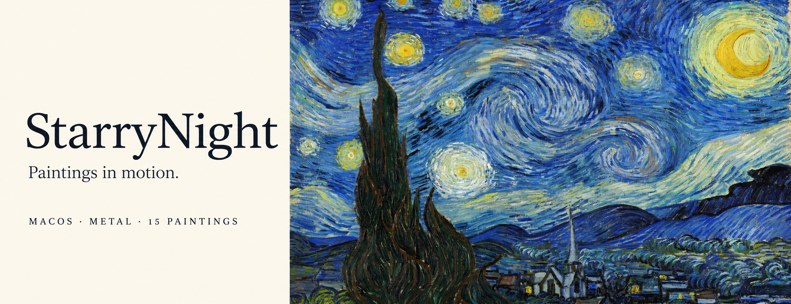
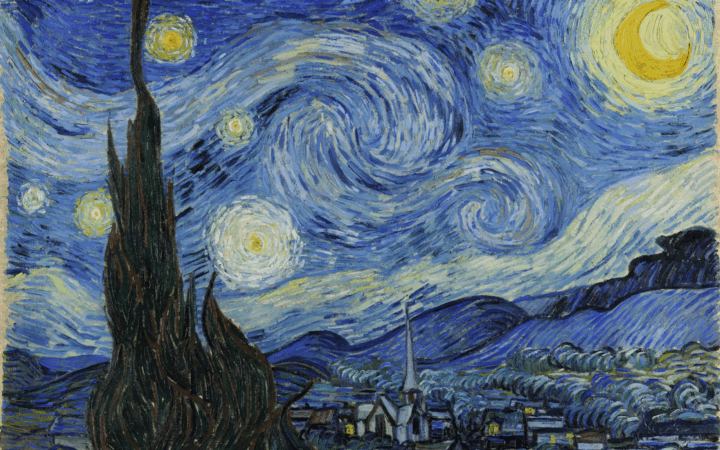
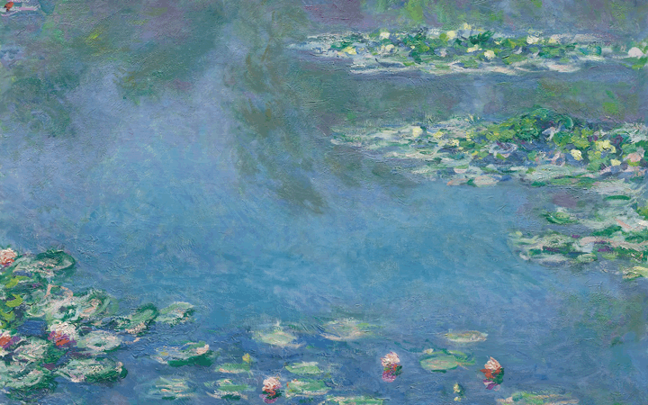
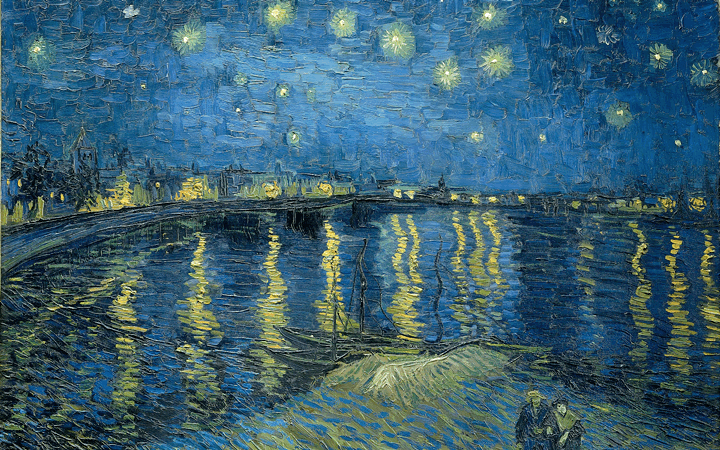
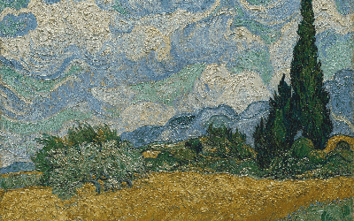
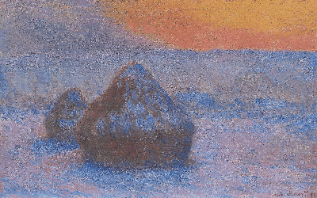
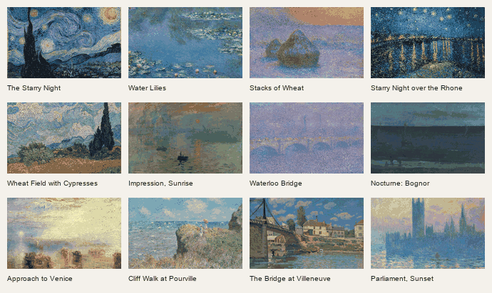
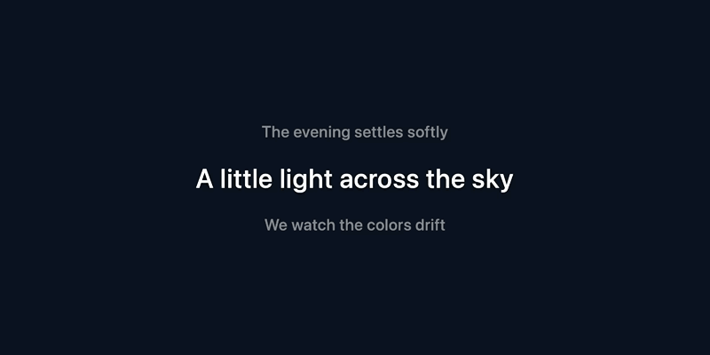

<p align="center">
  
</p>

<p align="center">
  <a href="README.zh-CN.md">简体中文</a> ·
  <a href="https://github.com/Rosemary1812/starry-night-wallpaper/releases">Download</a> ·
  <a href="THIRD-PARTY-NOTICES.md">Painting Sources</a> ·
  macOS 26 · Apple Silicon
</p>

<p align="center">
  <strong>Living paintings for your Mac desktop.</strong><br />
  Rendered natively in Metal so skies drift along the brushwork and water ripples while figures and architecture stay still—paired with a minimal Apple Music lyrics overlay.
</p>

<p align="center">
  <br />
  <sub><em>The Starry Night</em> · Vincent van Gogh, 1889 — 24-second Metal loop (4 fps preview; wallpapers render at 30 fps)</sub>
</p>

---

## The Collection

StarryNight ships with **15 paintings** in an infinitely scrolling native gallery. Every painting has its own Metal motion field and subject mask, so movement stays inside the sky, water, or light while foreground subjects hold still. The interface supports English, 简体中文, and 繁體中文.

<table>
  <tr>
    <td align="center" width="50%">
      <br />
      <sub><strong>Water Lilies</strong> · Claude Monet, 1906<br />Pond ripples around anchored lily pads</sub>
    </td>
    <td align="center" width="50%">
      <br />
      <sub><strong>Starry Night over the Rhône</strong> · Vincent van Gogh, 1888<br />Gaslight reflections shimmering across the river</sub>
    </td>
  </tr>
  <tr>
    <td align="center" width="50%">
      <br />
      <sub><strong>Wheat Field with Cypresses</strong> · Vincent van Gogh, 1889<br />Drifting clouds and wind across the wheat field</sub>
    </td>
    <td align="center" width="50%">
      <br />
      <sub><strong>Stacks of Wheat (Sunset, Snow Effect)</strong> · Claude Monet, 1890–1891<br />Subtle sky luminance shift without geometric warp</sub>
    </td>
  </tr>
</table>

<details>
<summary><strong>Browse all 15 paintings &amp; shortcuts</strong></summary>

<p align="center">
  <br />
  <sub>Overview of the first 12 paintings from v0.3.0; v0.4.0 adds <em>The Scream</em>, <em>Circular Forms</em>, and <em>Color Study</em>.</sub>
</p>

| Painting | Artist · Year | Motion | Shortcut |
| --- | --- | --- | --- |
| The Starry Night | Vincent van Gogh · 1889 | Swirling sky brushwork; cypress, hills, and village anchored | `⌘1` |
| Water Lilies | Claude Monet · 1906 | Rippling pond and reflections; lily clusters anchored | `⌘2` |
| Stacks of Wheat (Sunset, Snow Effect) | Claude Monet · 1890–1891 | Gentle warm-sky luminance shift; geometry completely still | `⌘3` |
| Starry Night over the Rhône | Vincent van Gogh · 1888 | Shimmering river reflections; shore, mast, and couple still | `⌘4` |
| Wheat Field with Cypresses | Vincent van Gogh · 1889 | Moving clouds and wheat; cypress and mid-hills still | `⌘5` |
| Impression, Sunrise | Claude Monet · 1872 | Water and orange reflections; sun, boats, and harbor still | `⌘6` |
| Waterloo Bridge, Sunlight Effect | Claude Monet · 1903 | Flowing river and arch reflections; bridge and skyline still | `⌘7` |
| Nocturne: Blue and Silver, Bognor | James McNeill Whistler · 1871–1876 | Slow sea swell; horizon, sailboats, and shore still | `⌘8` |
| Approach to Venice | J. M. W. Turner · 1844 | Shimmering lagoon; sky, city, and gondolas still | `⌘9` |
| Cliff Walk at Pourville | Claude Monet · 1882 | Separate cloud, sea, and grass currents; figures and cliffs still | `⌘0` |
| The Bridge at Villeneuve-la-Garenne | Alfred Sisley · 1872 | River currents; bridge, boats, and buildings still | `⌥⌘1` |
| The Houses of Parliament, Sunset | Claude Monet · 1903 | Short water reflection strokes; architecture and sky still | `⌥⌘2` |
| The Scream | Edvard Munch · 1893 | Rippling sky bands; figures, bridge, and fjord still | `⌥⌘3` |
| Circular Forms | Robert Delaunay · 1930 | Three rotating color groups; outer composition still | `⌥⌘5` |
| Color Study: Squares with Concentric Circles | Wassily Kandinsky · 1913 | Staggered turning rings; square grid still | `⌥⌘6` |

</details>

---

## Desktop Lyrics

An opt-in Apple Music companion overlay that floats pure typography directly on your desktop—no background box, just spring-animated lines synced to the current track.

<p align="center">
  
</p>

- **Automatic matching**: Opt in to fetch synchronized lyrics from [LRCLIB](https://lrclib.net/) using exact recording lookup with title/artist fallback. Network lookup stays off until you enable it.
- **Offline & manual LRC**: Fetched lyrics and per-track timing offsets are cached locally, and manually imported `.lrc` files always take priority.
- See [docs/automatic-lyrics.md](docs/automatic-lyrics.md) for setup, privacy details, and matching rules.

---

## Quick Start

Requires **macOS 26** and an **Apple Silicon Mac**.

1. **Download** the latest ZIP archive from [GitHub Releases](https://github.com/Rosemary1812/starry-night-wallpaper/releases) ([v0.4.0](https://github.com/Rosemary1812/starry-night-wallpaper/releases/tag/v0.4.0) includes all 15 paintings, desktop lyrics, and SHA-256 checksums).
2. **Install** by extracting `Starry Night.app` into `/Applications`. If Gatekeeper prompts on first launch, Control-click the app in Finder and choose **Open**.
3. **Apply**: Pick a painting, fine-tune speed or intensity in **Adjust…**, and click **Set Wallpaper**. On first use, open **System Settings → Wallpaper** once and select **StarryNight** so macOS initializes the extension.

> **Experimental build**: StarryNight uses private macOS wallpaper extension APIs, is ad hoc signed (not notarized), and is not distributed through the Mac App Store. Future macOS updates may affect extension compatibility.

### Controls & Export

| Feature | Details |
| --- | --- |
| **Speed** | `0.25×` – `2×` (a full loop is 24 s at `1×`, 96 s at `0.25×`, 12 s at `2×`) |
| **Intensity** | `0%` – `250%` (default `140%`; `0%` pauses displacement and light shift) |
| **Preview tools** | **Pause Preview** freezes only the window; **Show motion mask** highlights animated regions |
| **Appearance & Language** | Follows macOS Light/Dark mode and Reduce Motion; supports System, English, 简体中文, and 繁體中文 |
| **Video Export** | Open **… → Export Video…** to save a 30 fps looping H.264 MP4 at 3840 px width matching your main display's aspect ratio (**Set Wallpaper** renders at 2560 px wide, cropped to fill without stretching) |

---

<details>
<summary><strong>Troubleshooting</strong></summary>

| Symptom | What to do |
| --- | --- |
| App asks to open Wallpaper Settings first | Open **System Settings → Wallpaper** once, then return and click **Set Wallpaper**. |
| Render finishes, but desktop wallpaper didn't change | Select **StarryNight** in **System Settings → Wallpaper**. Preview tweaks alone don't update the desktop. |
| Center painting moves, neighboring thumbnails don't | Expected—only the settled selection runs a live Metal preview. |
| Motion looks very subtle | Raise **Intensity** in **Adjust…**. *Stacks of Wheat* intentionally uses a quiet luminance shift rather than displacement. |
| Buttons are briefly disabled | Wait for video rendering or carousel scrolling to settle. |
| Source build reports missing image or seed video | Verify filenames in `assets/` or the directory set in `STARRY_ASSETS_DIR`. |

</details>

<details>
<summary><strong>Build from source &amp; CLI rendering</strong></summary>

Requires macOS 26, Apple Silicon, and Xcode Command Line Tools (`Swift`, `AppKit`, `Metal`, `AVFoundation`—no Python or FFmpeg needed to build).

```sh
git clone --branch main https://github.com/Rosemary1812/starry-night-wallpaper.git
cd starry-night-wallpaper
xcode-select --install   # skip if already installed
mkdir -p assets
```

Place a reproduction of *The Starry Night* (for example, a reduced-size [public-domain copy from Wikimedia Commons](https://commons.wikimedia.org/wiki/File:Van_Gogh_-_Starry_Night_-_Google_Art_Project.jpg)) at `assets/starrynight.jpg`, then fetch the remaining 14 paintings:

```sh
zsh scripts/fetch-artworks.sh
```

Generate the seed loop and build both the app and wallpaper extension:

```sh
STARRY_SKIP_EXTENSION_BUILD=1 zsh build.sh
"./Starry Night.app/Contents/MacOS/StarryNight" \
  --export "$PWD/assets/starry-night-flow.mp4" 2560 1600
zsh build.sh
open "Starry Night.app"
```

Set `STARRY_ASSETS_DIR` if you store source images and `starry-night-flow.mp4` outside `assets/`.

#### Command-line rendering

Pass the painting's filename without `.jpg` to `--artwork`:

```sh
mkdir -p dist
"./Starry Night.app/Contents/MacOS/StarryNight" --snapshot "$PWD/dist/rhone.png" 8 --artwork rhone
"./Starry Night.app/Contents/MacOS/StarryNight" --export "$PWD/dist/rhone.mp4" 1920 1080 --artwork rhone
```

</details>

<details>
<summary><strong>Verification, README media &amp; code map</strong></summary>

Run gallery, localization, and Metal loop verification (with source assets present):

```sh
STARRY_VERIFY_EXPECTED_ARTWORK_COUNT=15 zsh scripts/verify-gallery.sh
```

Check visible GPU live previews and carousel wrap-around:

```sh
STARRY_VERIFY_LIVE_PREVIEW=1 \
  "./Starry Night.app/Contents/MacOS/StarryNight" \
  --ui-check "$PWD/dist/live-preview-evidence"
```

Regenerate README GIFs (details and attribution in [docs/media/README.md](docs/media/README.md)):

```sh
python3 -m pip install Pillow
zsh scripts/record-readme-media.sh
```

Before adding a painting or tuning its motion, read the [painting wallpaper authoring guide](.agents/skills/author-painting-wallpaper/SKILL.md).

| Path | Responsibility |
| --- | --- |
| `Artwork.swift` | Painting IDs, filenames, crops, years, and shortcuts |
| `StarryNight.swift`, `Sky.metal` | Metal renderer, masks, motion fields, video export, app lifecycle |
| `GalleryView.swift`, `CarouselMotion.swift` | Native gallery UI, controls, input, and infinite carousel |
| `DesktopLyrics.swift` | Apple Music desktop lyrics overlay and spring motion |
| `L10n.swift`, `*.lproj/` | Language selection and localized strings |
| `WallpaperBridge.swift`, `WallpaperExtension/` | Render handoff and macOS wallpaper playback extension |
| `Icons/`, `Fonts/` | Monochrome app icon and bundled Source Serif 4 |
| `scripts/` | Build, asset fetch, media capture, and verification scripts |

</details>

---

## Credits & Licenses

- **Code**: [MIT License](LICENSE). The wallpaper extension builds on [Phosphene](https://github.com/kageroumado/phosphene), and the bundled Adobe Source Serif 4 font uses the SIL Open Font License.
- **Artwork**: Painting reproductions carry their own terms—see [THIRD-PARTY-NOTICES.md](THIRD-PARTY-NOTICES.md). In particular, *Waterloo Bridge, Sunlight Effect* and its animated derivatives (including `painting-collection.gif`) are distributed under **CC BY-SA 4.0** (Claude Monet / Art Institute of Chicago, via Wikimedia Commons uploader Maltaper).
