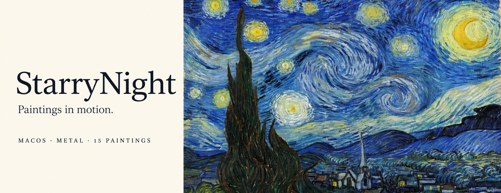
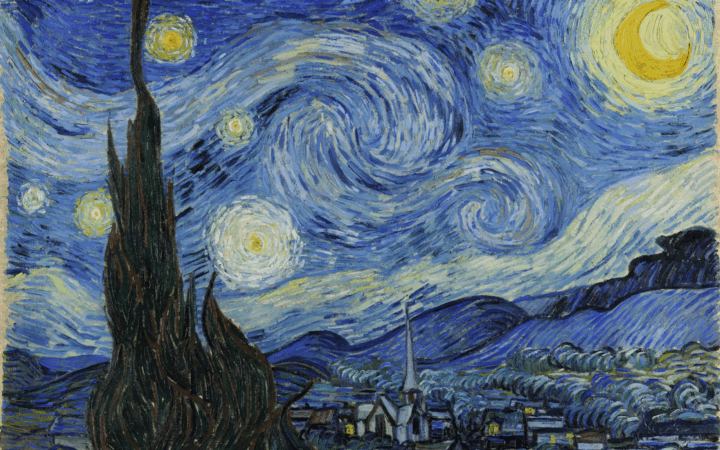
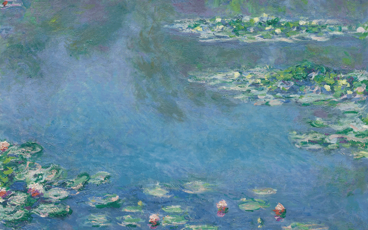
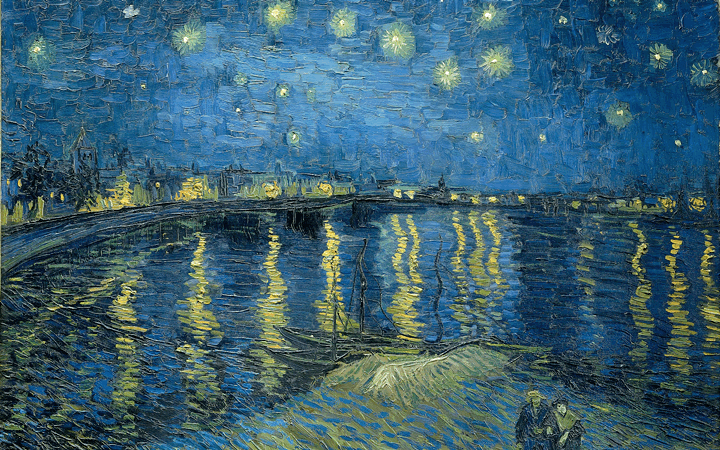
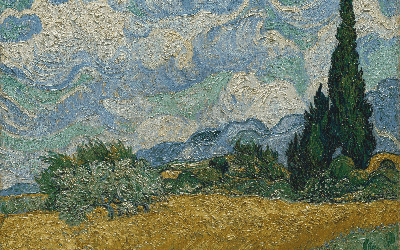
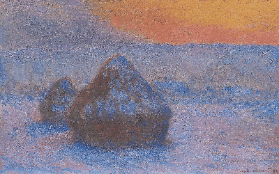
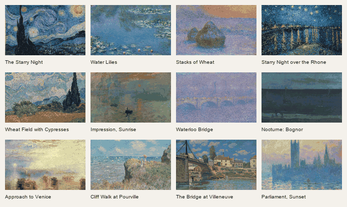
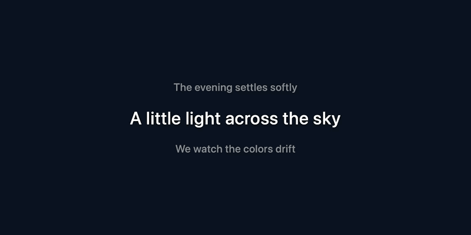

<p align="center">
  
</p>

<p align="center">
  <a href="README.md">English</a> ·
  <a href="https://github.com/Rosemary1812/starry-night-wallpaper/releases">下载应用</a> ·
  <a href="THIRD-PARTY-NOTICES.md">画作来源</a> ·
  macOS 26 · Apple Silicon
</p>

<p align="center">
  <strong>把名画变成会呼吸的 Mac 动态壁纸。</strong><br />
  由 Metal 独立驱动每幅画的流场与主体遮罩——笔触流转、水波微漾，画中人物与建筑依然安然静止；同时内置极简 Apple Music 桌面歌词。
</p>

<p align="center">
  <br />
  <sub>《星空》· 文森特·梵高，1889 — 24 秒 Metal 无缝循环（预览为 4 fps，实际壁纸以 30 fps 渲染）</sub>
</p>

---

## 馆藏画作

内置 **15 幅画作**，在可无限循环滚动的原生画廊中自由浏览。每幅画都有专属的 Metal 动效流场与主体遮罩，让云层、水面与光影自然流动，前景主体保持安定。界面支持简体中文、繁體中文与 English。

<table>
  <tr>
    <td align="center" width="50%">
      <br />
      <sub><strong>睡莲</strong> · 克劳德·莫奈，1906<br />水面与倒影微漾，睡莲花簇安然静止</sub>
    </td>
    <td align="center" width="50%">
      <br />
      <sub><strong>罗讷河上的星夜</strong> · 文森特·梵高，1888<br />河面灯影轻轻摇曳，岸线与人物静止</sub>
    </td>
  </tr>
  <tr>
    <td align="center" width="50%">
      <br />
      <sub><strong>有柏树的麦田</strong> · 文森特·梵高，1889<br />卷云与麦浪拂动，柏树与山丘守望</sub>
    </td>
    <td align="center" width="50%">
      <br />
      <sub><strong>麦草堆：日落与雪景</strong> · 克劳德·莫奈，1890–1891<br />暖色天光缓步明暗呼吸，画面几何不形变</sub>
    </td>
  </tr>
</table>

<details>
<summary><strong>展开查看全部 15 幅画作与快捷键</strong></summary>

<p align="center">
  <br />
  <sub>合集预览展示 v0.3.0 的 12 幅画作；v0.4.0 新增《呐喊》《圆形构图》与《色彩习作：同心圆方格》。</sub>
</p>

| 画作 | 作者 · 年代 | 动效特点 | 快捷键 |
| --- | --- | --- | --- |
| 星空 | 文森特·梵高 · 1889 | 螺旋星云顺笔触流动；柏树、山丘与村庄静止 | `⌘1` |
| 睡莲 | 克劳德·莫奈 · 1906 | 池水与倒影起伏；睡莲花簇静止 | `⌘2` |
| 麦草堆：日落与雪景 | 克劳德·莫奈 · 1890–1891 | 暖色天空局部明暗变化；草堆与雪地完全固定 | `⌘3` |
| 罗讷河上的星夜 | 文森特·梵高 · 1888 | 河面灯影摇曳；岸线、船桅与人物静止 | `⌘4` |
| 有柏树的麦田 | 文森特·梵高 · 1889 | 云层与麦浪流动；主柏树与中景山丘静止 | `⌘5` |
| 日出·印象 | 克劳德·莫奈 · 1872 | 水面与橙色日影荡漾；太阳、小舟与港口静止 | `⌘6` |
| 滑铁卢桥：阳光效果 | 克劳德·莫奈 · 1903 | 河水与桥洞倒影微动；桥体与城市轮廓静止 | `⌘7` |
| 蓝与银的夜曲：博格诺 | 詹姆斯·麦克尼尔·惠斯勒 · 1871–1876 | 海面缓慢起伏；地平线、帆船与岸线静止 | `⌘8` |
| 驶近威尼斯 | 约瑟夫·马洛德·威廉·特纳 · 1844 | 潟湖水波闪动；天空、城市与贡多拉静止 | `⌘9` |
| 普维尔悬崖漫步 | 克劳德·莫奈 · 1882 | 云层、海面与草叶分区流动；人物、阳伞与崖壁静止 | `⌘0` |
| 维尔纳夫拉加伦的桥 | 阿尔弗雷德·西斯莱 · 1872 | 河水与倒影流淌；桥梁、船只与建筑静止 | `⌥⌘1` |
| 国会大厦，日落 | 克劳德·莫奈 · 1903 | 水面短横笔触微动；建筑、船只与天空静止 | `⌥⌘2` |
| 呐喊 | 爱德华·蒙克 · 1893 | 天空色带波动；人物、桥梁与峡湾静止 | `⌥⌘3` |
| 圆形构图 | 罗伯特·德洛内 · 1930 | 三组色环回旋；画面外围静止 | `⌥⌘5` |
| 色彩习作：同心圆方格 | 瓦西里·康定斯基 · 1913 | 圆环错相回旋；方格边界静止 | `⌥⌘6` |

</details>

---

## 桌面歌词

可选的 Apple Music 桌面歌词浮层——没有背景底框，只有随播放进度弹性滚动的纯净文字，直接浮在画作桌面之上。

<p align="center">
  
</p>

- **自动匹配歌词**：开启后通过 [LRCLIB](https://lrclib.net/) 精确匹配录音版本，未命中时自动按歌名与歌手检索候选；联网查询默认关闭，仅在你显式启用后生效。
- **离线缓存与手动 LRC**：歌词与每曲时间偏移保存在本地、支持离线阅读，手动导入的 `.lrc` 文件始终优先。
- 详细配置、隐私说明与匹配规则见 [docs/automatic-lyrics.md](docs/automatic-lyrics.md)。

---

## 快速上手

需要 **macOS 26** 与 **Apple Silicon Mac**。

1. **下载安装**：前往 [GitHub Releases](https://github.com/Rosemary1812/starry-night-wallpaper/releases) 下载 ZIP 包（[v0.4.0](https://github.com/Rosemary1812/starry-night-wallpaper/releases/tag/v0.4.0) 包含全部 15 幅画作、桌面歌词与 SHA-256 校验文件），解压并将 `Starry Night.app` 移入「应用程序」。
2. **首次打开**：如 macOS 提示无法验证开发者，在 Finder 中按住 Control 点击应用并选择 **打开**。
3. **设为壁纸**：选好画作，按需在 **调整…** 中设定速度与强度，点击 **设为壁纸**。首次使用请先打开一次 **系统设置 → 壁纸** 并选中 **StarryNight**，让系统初始化扩展。

> **实验性说明**：壁纸扩展基于 macOS 私有 API，采用 ad hoc 签名且未公证，不面向 Mac App Store；后续 macOS 系统更新可能影响兼容性。

### 预览控制与视频导出

| 功能 | 说明 |
| --- | --- |
| **速度** | `0.25×` – `2×`（`1×` 为 24 秒循环，`0.25×` 为 96 秒，`2×` 为 12 秒） |
| **强度** | `0%` – `250%`（默认 `140%`；`0%` 时关闭位移与明暗变化） |
| **预览工具** | **暂停预览** 仅暂停窗口动画；**显示活动区域** 可临时高亮动效遮罩 |
| **外观与语言** | 跟随系统深浅色与「减少动态效果」；支持跟随系统、简体中文、繁體中文与 English |
| **导出视频** | 在 **… → 导出视频…** 中导出 30 fps、宽 3840 px 的循环 H.264 MP4（宽高比跟随主屏幕）；**设为壁纸** 以 2560 px 宽度渲染，均采用裁切铺满、不拉伸原画 |

---

<details>
<summary><strong>常见问题</strong></summary>

| 现象 | 处理方式 |
| --- | --- |
| 应用提示先打开系统壁纸设置 | 打开一次 **系统设置 → 壁纸**，返回应用后再次点击 **设为壁纸**。 |
| 渲染完成，但桌面仍是旧壁纸 | 在 **系统设置 → 壁纸** 中选中 **StarryNight**；仅修改预览不会更新桌面。 |
| 中间的画会动，旁边的缩略图不动 | 正常行为——只有当前选中并停稳的画作运行实时 Metal 预览。 |
| 某些画作动效较轻 | 在 **调整…** 中提高强度；《麦草堆》刻意采用克制的局部天光明暗变化。 |
| 按钮暂时不可点击 | 等待视频渲染完成或画廊滚动停稳即可。 |
| 源码构建提示缺少图片或初始视频 | 检查 `assets/` 目录或 `STARRY_ASSETS_DIR` 环境变量中的文件名。 |

</details>

<details>
<summary><strong>从源码构建与命令行渲染</strong></summary>

需要 macOS 26、Apple Silicon 与 Xcode Command Line Tools（使用 Swift、AppKit、Metal 与 AVFoundation，构建本身无需 Python 或 FFmpeg）。

```sh
git clone --branch main https://github.com/Rosemary1812/starry-night-wallpaper.git
cd starry-night-wallpaper
xcode-select --install   # 若已安装可跳过
mkdir -p assets
```

将可合法使用的《星空》复制图（例如 [Wikimedia Commons 公共领域版本](https://commons.wikimedia.org/wiki/File:Van_Gogh_-_Starry_Night_-_Google_Art_Project.jpg)的缩小图）保存为 `assets/starrynight.jpg`，再下载其余 14 幅画作：

```sh
zsh scripts/fetch-artworks.sh
```

生成扩展所需的初始循环视频并完成完整构建：

```sh
STARRY_SKIP_EXTENSION_BUILD=1 zsh build.sh
"./Starry Night.app/Contents/MacOS/StarryNight" \
  --export "$PWD/assets/starry-night-flow.mp4" 2560 1600
zsh build.sh
open "Starry Night.app"
```

如需将素材与 `starry-night-flow.mp4` 放在其他目录，在下载与构建前设置 `STARRY_ASSETS_DIR`。

#### 命令行渲染

`--artwork` 传入不含 `.jpg` 的画作文件名：

```sh
mkdir -p dist
"./Starry Night.app/Contents/MacOS/StarryNight" --snapshot "$PWD/dist/rhone.png" 8 --artwork rhone
"./Starry Night.app/Contents/MacOS/StarryNight" --export "$PWD/dist/rhone.mp4" 1920 1080 --artwork rhone
```

</details>

<details>
<summary><strong>验证、录制与代码结构</strong></summary>

准备好画作素材后，可运行完整画廊、本地化与 Metal 循环验证：

```sh
STARRY_VERIFY_EXPECTED_ARTWORK_COUNT=15 zsh scripts/verify-gallery.sh
```

检查可见窗口中的实时 GPU 预览与首尾循环切换：

```sh
STARRY_VERIFY_LIVE_PREVIEW=1 \
  "./Starry Night.app/Contents/MacOS/StarryNight" \
  --ui-check "$PWD/dist/live-preview-evidence"
```

重新生成 README 动图（参数与署名说明见 [docs/media/README.md](docs/media/README.md)）：

```sh
python3 -m pip install Pillow
zsh scripts/record-readme-media.sh
```

新增画作或调整动效前，请先阅读 [画作动态壁纸创作指南](.agents/skills/author-painting-wallpaper/SKILL.md)。

| 路径 | 职责 |
| --- | --- |
| `Artwork.swift` | 画作 ID、文件名、裁切区域、年代与快捷键 |
| `StarryNight.swift`、`Sky.metal` | Metal 渲染器、遮罩、动效流场、视频导出与应用生命周期 |
| `GalleryView.swift`、`CarouselMotion.swift` | 原生画廊界面、控件、交互与无限滚动 |
| `DesktopLyrics.swift` | Apple Music 桌面歌词浮层与弹性滚动 |
| `L10n.swift`、`*.lproj/` | 语言选择与多语言本地化 |
| `WallpaperBridge.swift`、`WallpaperExtension/` | 渲染交付与 macOS 壁纸播放扩展 |
| `Icons/`、`Fonts/` | 黑白应用图标与内置 Source Serif 4 字体 |
| `scripts/` | 构建、素材下载、动图录制与验证脚本 |

</details>

---

## 致谢与许可

- **代码**：采用 [MIT License](LICENSE)。壁纸扩展派生自 [Phosphene](https://github.com/kageroumado/phosphene)，内置 Adobe Source Serif 4 字体采用 SIL Open Font License。
- **画作**：各复制图遵循各自授权条款，详见 [THIRD-PARTY-NOTICES.md](THIRD-PARTY-NOTICES.md)。其中《滑铁卢桥：阳光效果》及其动画衍生内容（含 `painting-collection.gif`）保留 **CC BY-SA 4.0** 许可（署名：Claude Monet / Art Institute of Chicago，经 Wikimedia Commons 上传者 Maltaper 提供）。
